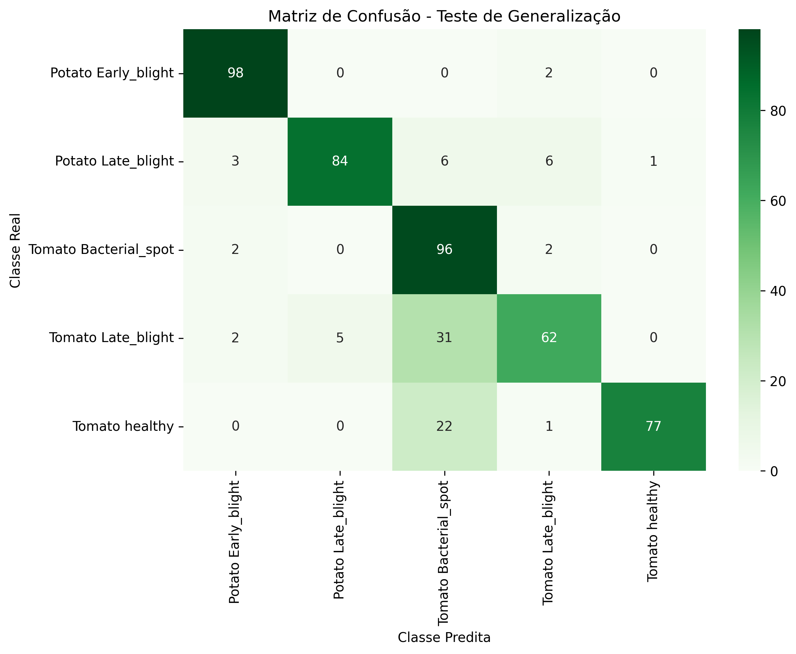

# Classificação de Doenças em Plantas com Few-Shot Learning

Projeto de classificação de doenças em plantas utilizando aprendizado *few-shot*, extração de características com ResNet18 e classificação baseada em protótipos.

## Sobre o projeto

Este projeto explora a aplicação de técnicas de *Few-Shot Learning* na classificação de doenças em plantas. A proposta é investigar a capacidade de um modelo de reconhecer diferentes classes a partir de uma quantidade reduzida de imagens de suporte (*support set*).

Para isso, é utilizado o conjunto de dados PlantVillage, uma rede ResNet18 pré-treinada para extração de características e um classificador baseado em protótipos.

## Objetivo

Implementar e avaliar uma abordagem de classificação *5-way 5-shot*, na qual o modelo utiliza cinco classes e apenas cinco imagens de suporte por classe para realizar a classificação de novas imagens.

## Tecnologias utilizadas

- Python
- PyTorch
- Torchvision
- NumPy
- Matplotlib
- Seaborn
- Scikit-learn
- Jupyter Notebook

## Metodologia

O experimento utiliza cinco classes do conjunto PlantVillage:

- Tomato Bacterial Spot
- Tomato Late Blight
- Tomato Healthy
- Potato Early Blight
- Potato Late Blight

O cenário experimental é configurado da seguinte forma:

| Conjunto | Quantidade |
|---|---:|
| Classes | 5 |
| Imagens de suporte por classe | 5 |
| Total de imagens de suporte | 25 |
| Imagens de consulta por classe | 100 |
| Total de imagens de consulta | 500 |

### Matriz de confusão

A matriz de confusão apresenta a distribuição das classificações corretas e incorretas para cada uma das cinco classes avaliadas.



### Extração de características

A ResNet18 pré-treinada é utilizada como extratora de características. Sua camada classificadora original é removida e seus parâmetros permanecem congelados durante o experimento.

### Extração de características locais

Além das características globais, são extraídas características locais utilizando cinco recortes determinísticos (*FiveCrop*) de cada imagem.

Essas representações são processadas por um mecanismo de atenção baseado em `MultiheadAttention`, permitindo combinar informações dos diferentes recortes.

### Classificação baseada em protótipos

As representações das imagens de suporte são utilizadas para calcular um protótipo para cada classe, obtido pela média das características de seus exemplos.

As imagens de consulta são classificadas de acordo com a distância euclidiana entre suas representações e os protótipos calculados.

## Resultados

Na execução experimental realizada, foram obtidos os seguintes resultados:

| Métrica | Resultado |
|---|---:|
| Acurácia | 83,4% |
| Imagens classificadas corretamente | 417 |
| Imagens classificadas incorretamente | 83 |
| Total de imagens avaliadas | 500 |

A avaliação também contempla métricas de precisão (*precision*), revocação (*recall*) e F1-score, além da matriz de confusão.

## Estrutura do projeto

```text
few-shot-plant-disease-classification/
├── notebooks/
│   └── few_shot_plant_disease_classification.ipynb
├── results/
├── .gitignore
└── requirements.txt
```

## Como executar

### 1. Clonar o repositório

```bash
git clone https://github.com/michelleegit/few-shot-plant-disease-classification.git
cd few-shot-plant-disease-classification
```

### 2. Criar um ambiente virtual

```bash
python3 -m venv .venv
source .venv/bin/activate
```

### 3. Instalar as dependências

Para instalar a versão CPU do PyTorch utilizada no desenvolvimento:

```bash
python -m pip install torch==2.4.1 torchvision==0.19.1 \
  --index-url https://download.pytorch.org/whl/cpu
```

Em seguida:

```bash
python -m pip install -r requirements.txt
```

### 4. Executar o notebook

```bash
python -m notebook
```

Abra o arquivo `notebooks/few_shot_plant_disease_classification.ipynb` no Jupyter Notebook e execute as células em sequência.

## Observações

- O experimento utiliza pesos pré-treinados da ResNet18.
- A rede backbone permanece congelada.
- Os pesos de projeção do mecanismo de atenção são inicializados e mantidos fixos; não há treinamento desses parâmetros.
- Os resultados apresentados correspondem à configuração experimental descrita neste repositório.